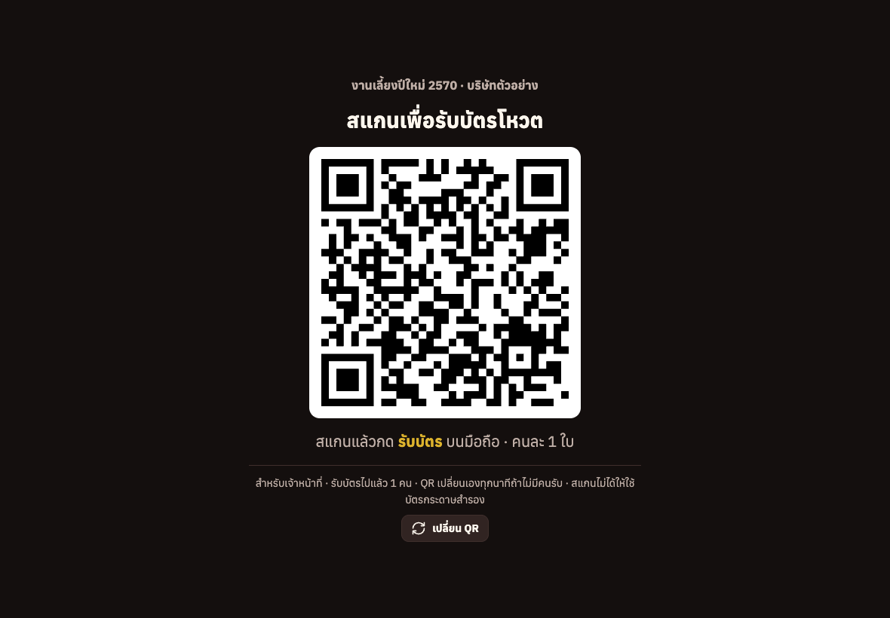
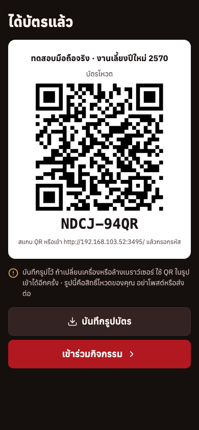

# คู่มือจุดลงทะเบียน: สแกนเพื่อรับบัตรโหวต

ใช้กับเว็บโหวตประกวดในงานเลี้ยงบริษัท สำหรับผู้จัดงานและเจ้าหน้าที่โต๊ะลงทะเบียน

แขกที่มาถึงงานสแกน QR บนจอที่โต๊ะลงทะเบียน กด "รับบัตร" บนมือถือตัวเอง แล้วได้บัตรโหวตของตัวเอง ไม่ต้องพิมพ์บัตรล่วงหน้าทุกใบ และไม่ต้องเก็บอีเมลของใคร

## คำที่ใช้ในคู่มือนี้

- **จอจุดลงทะเบียน** คือหน้า `/checkin` ที่เปิดบนแท็บเล็ตหรือโน้ตบุ๊กที่โต๊ะลงทะเบียน แยกจากจอใหญ่บนเวที
- **บัตรโหวต** คือ QR พร้อมรหัส 8 ตัว เช่น `HWR7-MAMQ` ใช้เชียร์และโหวตได้ตลอดงาน คนละ 1 ใบ
- **ตั๋วรับบัตร** คือ QR ที่อยู่บนจอจุดลงทะเบียน ใช้ได้ครั้งเดียว ไม่ใช่รหัสโหวต ใครถ่ายรูปจอไปก็เอาไปโหวตไม่ได้
- **บัตรกระดาษสำรอง** คือบัตรโหวตที่พิมพ์จากหน้าแอดมินไว้แจกคนที่สแกนไม่ได้

## ใช้เมื่อไร

แอปมีวิธีแจกบัตรโหวต 3 แบบ เลือกใช้แบบเดียวหรือใช้ร่วมกันก็ได้

| วิธี | เหมาะกับ |
|---|---|
| พิมพ์บัตรกระดาษ | งานเล็ก หรือแขกส่วนใหญ่ไม่สะดวกใช้มือถือ |
| ส่งรหัสทางอีเมล | รู้รายชื่อและอีเมลล่วงหน้า และอยากให้เข้าโหวตก่อนถึงงาน |
| **จุดลงทะเบียน (คู่มือนี้)** | แขกลงทะเบียนหน้างานอยู่แล้ว ไม่อยากพิมพ์บัตรทุกใบ และไม่อยากเก็บอีเมล |

## ต้องเตรียม

- [ ] เซิร์ฟเวอร์เปิดอยู่ และมือถือในงานเข้าลิงก์โหวตได้ ลองเปิดด้วยมือถือที่ต่อ Wi-Fi ของงาน หรือใช้เน็ตมือถือถ้าเซิร์ฟเวอร์อยู่บนอินเทอร์เน็ต
- [ ] วิธีเข้าโหวตตั้งเป็น **"รหัสโหวต"** (แท็บ "ตั้งค่างาน") จุดลงทะเบียนใช้ไม่ได้กับแบบอื่น
- [ ] แท็บเล็ตหรือโน้ตบุ๊ก 1 เครื่องต่อ 1 โต๊ะ จอยิ่งใหญ่ยิ่งสแกนง่าย พร้อมสายชาร์จ
- [ ] บัตรกระดาษสำรอง ราว 10% ของจำนวนแขก (ดูหัวข้อ "เตรียมบัตรกระดาษสำรอง")
- [ ] ป้ายตั้งโต๊ะ (มีข้อความให้คัดลอกท้ายคู่มือ)

## ก่อนงาน (ทำครั้งเดียว ราว 10 นาที)

1. เปิดหน้าแอดมินบน**เครื่องที่จะวางที่โต๊ะ** แล้วเข้าสู่ระบบ
   หน้าจุดลงทะเบียนใช้สิทธิ์แอดมินของเครื่องนั้น การเข้าสู่ระบบอยู่ได้ 24 ชั่วโมง ควรเข้าในวันงาน ไม่ใช่วันก่อน
2. ไปที่แท็บ **"ตั้งค่างาน"** ในกล่อง **"จุดลงทะเบียนหน้างาน"** กด **"เปิดหน้าจุดลงทะเบียน"**
3. จะได้หน้าจอแบบนี้ ตั้งเครื่องให้หันจอไปทางแขก

   

4. ปิดการล็อกจออัตโนมัติของเครื่อง หน้านี้พยายามเปิดจอค้างไว้ให้เอง แต่บางเครื่องไม่ยอม
5. **ซ้อมหนึ่งรอบ** ใช้มือถือของเจ้าหน้าที่สแกนและรับบัตร 1 ใบ ตามหัวข้อถัดไป ถ้าได้บัตรแล้วกด "เข้าร่วมกิจกรรม" เข้าได้ แปลว่าพร้อม
   บัตรที่ซ้อมนี้เป็นบัตรจริง 1 ใบ ถ้าไม่อยากให้ติดอยู่ในผลโหวต ให้ซ้อมก่อนวันงานแล้วกด "ล้างผลโหวตทั้งหมด" ในแท็บตั้งค่างาน

## หน้างาน: แขกทำอะไรบ้าง

**ขั้นที่ 1 สแกน QR บนจอ** ด้วยกล้องมือถือ แล้วแตะลิงก์ที่เด้งขึ้นมา

**ขั้นที่ 2 กด "รับบัตร"** ตั๋วจะยังไม่ถูกใช้จนกว่าจะกดปุ่มนี้ แค่สแกนเฉย ๆ หรือส่งลิงก์ไปในแชตจึงไม่ทำให้ตั๋วหาย

**ขั้นที่ 3 ได้บัตรแล้ว** กด **"บันทึกรูปบัตร"** เก็บไว้ในเครื่อง แล้วกด **"เข้าร่วมกิจกรรม"** ได้เลย ไม่ต้องกรอกรหัส

- บนมือถือส่วนใหญ่ "บันทึกรูปบัตร" จะเปิดเมนูแชร์ ให้เลือก **"บันทึกรูปภาพ"** ถ้าบันทึกไม่ได้ จะมีข้อความให้แคปหน้าจอแทน ได้ผลเหมือนกัน
- เปิดหน้านี้อีกครั้งบนเครื่องเดิม บัตรยังอยู่
- เปลี่ยนเครื่องหรือล้างเบราว์เซอร์: เข้าลิงก์โหวตแล้วกด **"เปิดจากรูปบัตรที่บันทึกไว้"** เลือกรูปบัตรในเครื่อง (รูปแคปหน้าจอหรือรูปถ่ายบัตรกระดาษก็ได้) หรือกรอกรหัสบนบัตร หรือใช้มือถืออีกเครื่องสแกน QR ในรูป

## หน้างาน: เจ้าหน้าที่ทำอะไรบ้าง

- **ไม่ต้องกดอะไรระหว่างแขกรับบัตร** พอแขกกด "รับบัตร" จอจะขึ้น **"รับบัตรแล้ว · เชิญคนถัดไป"** ราว 2 วินาที แล้วเปลี่ยนเป็น QR ใหม่เอง
- ถ้าไม่มีใครรับภายใน 1 นาที QR จะเปลี่ยนเอง ตั๋วเก่าใช้ไม่ได้แล้ว
- ปุ่ม **"เปลี่ยน QR"** ใช้เมื่อสงสัยว่ามีคนถ่ายรูปจอไป หรือแขกสแกนแล้วเดินไปโดยยังไม่ได้กด "รับบัตร"
- บรรทัดล่างของจอบอกว่ารับบัตรไปแล้วกี่คน ในแท็บ "ตั้งค่างาน" ของหน้าแอดมินก็มีตัวเลขนี้
- **คนละ 1 ใบ** ระบบไม่รู้ว่าใครเป็นใคร เจ้าหน้าที่ต้องดูเองว่าแต่ละคนสแกนครั้งเดียว เหมือนการแจกบัตรกระดาษ
- **คอยดูจอเสมอ อย่าปล่อยโต๊ะว่าง** ถ้าจอขึ้น "รับบัตรแล้ว" ทั้งที่ไม่มีแขกยืนอยู่ หรือตัวเลขรับบัตรเพิ่มเร็วผิดปกติ แปลว่าอาจมีคนส่องกล้องรับบัตรจากระยะไกล ให้กด "เปลี่ยน QR" บังจอ หรือหันจอออกจากคนนั้น ถ้าต้องลุกจากโต๊ะ ให้ปิดหน้าจุดลงทะเบียนหรือคว่ำจอไว้

บทพูดสั้น ๆ สำหรับเจ้าหน้าที่:

> "สแกน QR บนจอนี้ แล้วกดปุ่มแดง 'รับบัตร' นะคะ ได้บัตรแล้วกด 'บันทึกรูป' เก็บไว้ จากนั้นกด 'เข้าร่วมกิจกรรม' ได้เลย"

## ปัญหาที่เจอบ่อย

| อาการ | ทำแบบนี้ |
|---|---|
| จอขึ้น "ต้องเข้าสู่ระบบแอดมินก่อน" | การเข้าสู่ระบบบนเครื่องนี้หมดอายุหรือยังไม่ได้เข้า กด "ไปหน้าแอดมิน" เข้าสู่ระบบ แล้วเปิดหน้าจุดลงทะเบียนใหม่ |
| จอขึ้น "จุดลงทะเบียนใช้ได้เฉพาะวิธีเข้าโหวตแบบ รหัสโหวต" | แท็บ "ตั้งค่างาน" เปลี่ยนวิธีเข้าโหวตเป็น "รหัสโหวต" |
| มือถือขึ้น "QR นี้ใช้ไปแล้วหรือหมดอายุ" | ตั๋วหมดอายุ (เกิน 1 นาที) หรือมีคนกดรับไปก่อน ให้สแกน QR ใหม่บนจอ |
| สแกนแล้วเปิดเว็บไม่ขึ้น | มือถือไม่ได้ต่อ Wi-Fi ของงาน หรือลิงก์ใน QR ผิด ตรวจ "ลิงก์ที่ QR พาไป" ในแท็บตั้งค่างาน ถ้ายังไม่ได้ ให้บัตรกระดาษสำรอง |
| มือถือเก่าหรือแขกไม่สะดวกสแกน | ให้บัตรกระดาษสำรอง 1 ใบ |
| แขกบอกว่ารับบัตรแล้วแต่บัตรหาย | ถ้ายังใช้มือถือเครื่องเดิม เปิดลิงก์โหวตแล้วจะยังเข้าได้อยู่ ถ้าเปลี่ยนเครื่องและไม่ได้บันทึกรูปไว้ ให้บัตรกระดาษสำรอง (บัตรเก่ายังอยู่ในระบบ แต่ไม่มีใครรู้รหัส) |
| จอดับหรือเครื่องล็อก | ปลดล็อกแล้วหน้าจอจะทำงานต่อเอง QR ที่เห็นเป็นอันใหม่ |

## เตรียมบัตรกระดาษสำรอง

1. แท็บ **"ตั้งค่างาน"** ใส่จำนวนบัตรสำรองที่ต้องการ แล้วกด **"สร้างรหัส"**
2. กด **"พิมพ์บัตรรหัส"** แล้วพิมพ์ออกมา ตัดเป็นใบ
3. เก็บไว้ที่โต๊ะ **อย่าวางให้หยิบเอง** บัตรแต่ละใบคือสิทธิ์โหวต 1 สิทธิ์

## ข้อจำกัดที่ควรรู้

QR ใหม่ขึ้นทันทีหลังมีคนรับบัตร แถวจึงเดินเร็ว แต่ก็แปลว่าคนที่ตั้งกล้องส่องจอไว้ตลอดและใช้โปรแกรมกดรับอัตโนมัติ จะรับบัตรได้เรื่อย ๆ (ราวทุก 2–3 วินาที) ระบบไม่ได้กันข้อนี้ไว้ เพราะการกันต้องให้เจ้าหน้าที่กดปุ่มก่อนขึ้น QR ทุกคน สิ่งที่กันได้คือเจ้าหน้าที่ที่คอยดูจอตามหัวข้อด้านบน ความเสี่ยงนี้ใกล้เคียงกับการแอบหยิบบัตรกระดาษจากโต๊ะ

## ทำไมจอไม่แสดงรหัสโหวต

ถ้าจอแสดงรหัสโหวตตรง ๆ คนที่ยืนต่อแถวถ่ายรูปจอไปก็โหวตแทนคนอื่นได้ จอจึงแสดงแค่ตั๋วรับบัตร ซึ่ง

- ใช้ได้ครั้งเดียว คนแรกที่กด "รับบัตร" ได้ไป ที่เหลือใช้ไม่ได้
- หมดอายุใน 1 นาทีถ้าไม่มีใครรับ
- รหัสโหวตจริงถูกสร้างตอนกด "รับบัตร" และแสดงบนมือถือของคนนั้นคนเดียว

## หลังงาน

- ปิดหน้าจุดลงทะเบียน และออกจากระบบแอดมินบนเครื่องที่โต๊ะ
- บัตรกระดาษสำรองที่เหลือ ทิ้งได้เลย (หรือกด "ลบรหัสทั้งหมด" ถ้าจะไม่ใช้อีก)

## ข้อความป้ายตั้งโต๊ะ (คัดลอกไปพิมพ์ได้)

> **รับบัตรโหวตที่นี่**
> 1. สแกน QR บนจอ
> 2. กด **"รับบัตร"**
> 3. กด **"บันทึกรูปบัตร"** เก็บไว้
>
> คนละ 1 ใบ · บัตรคือสิทธิ์โหวตของคุณ อย่าโพสต์หรือส่งต่อ
> สแกนไม่ได้? ขอบัตรกระดาษจากเจ้าหน้าที่
